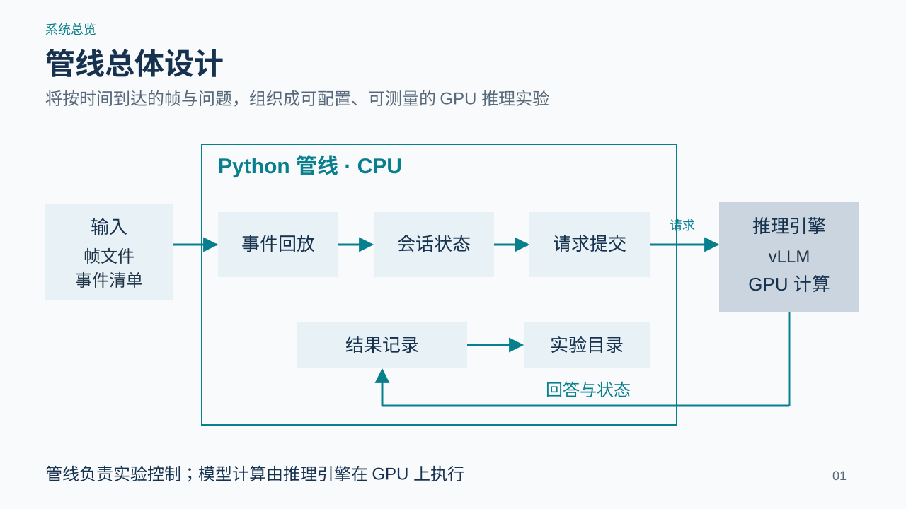
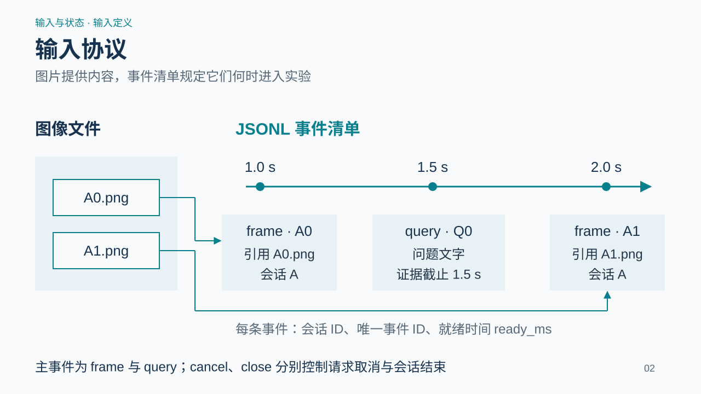
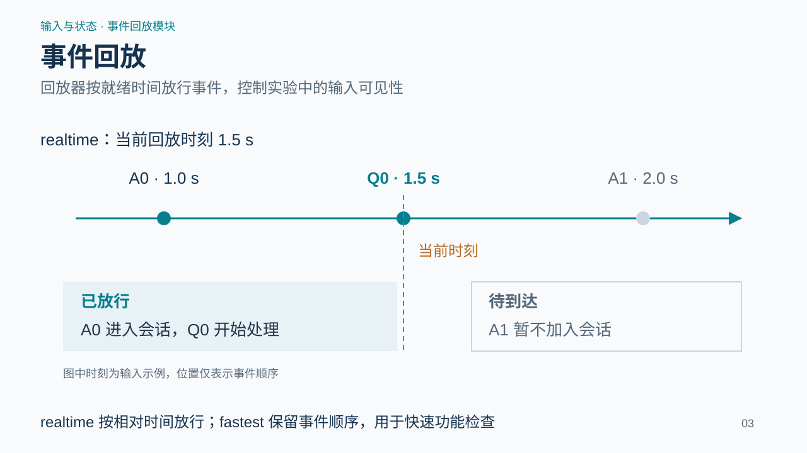
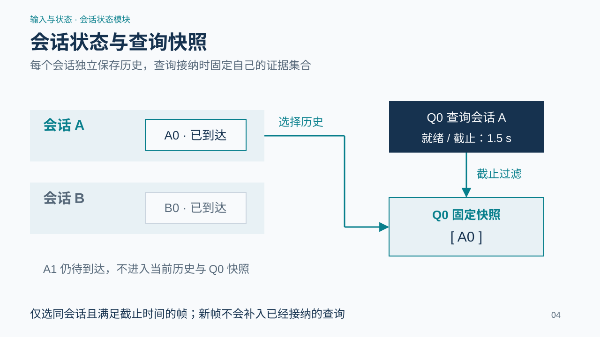
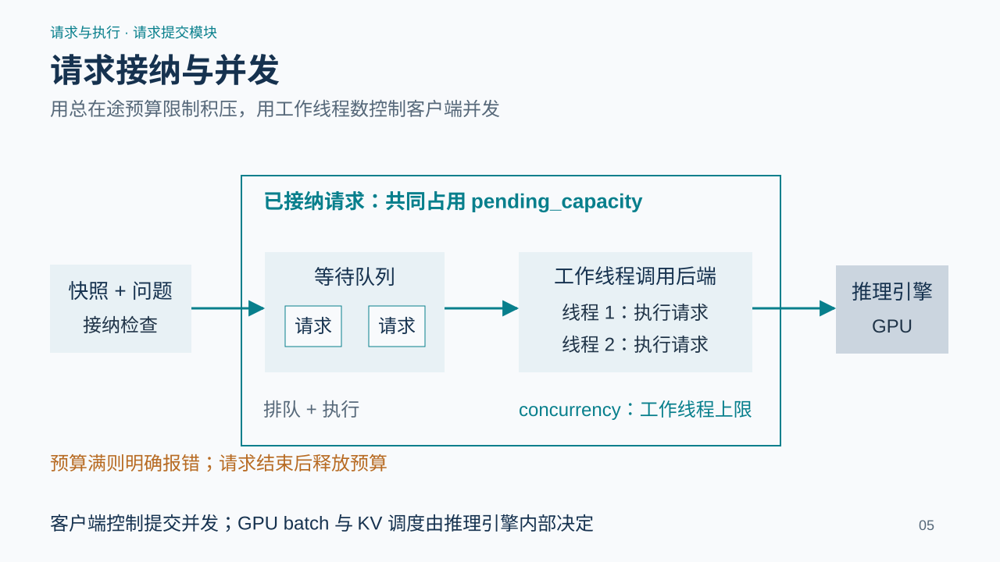
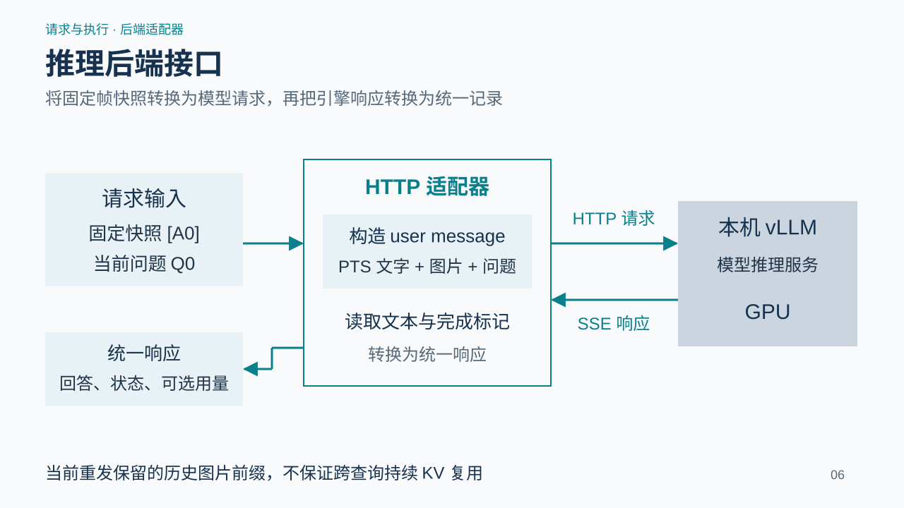
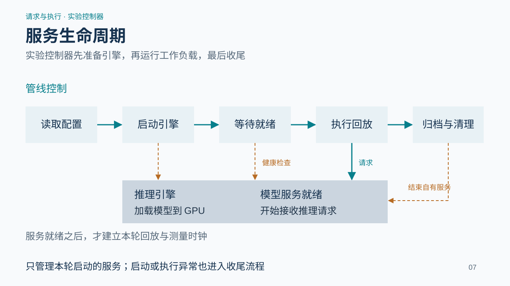
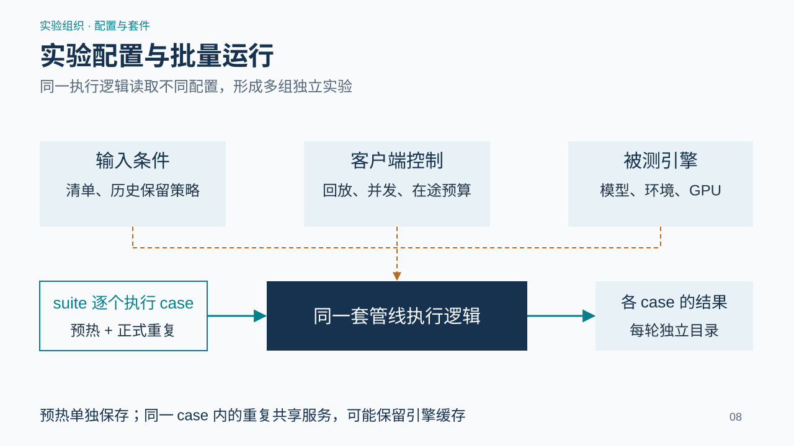
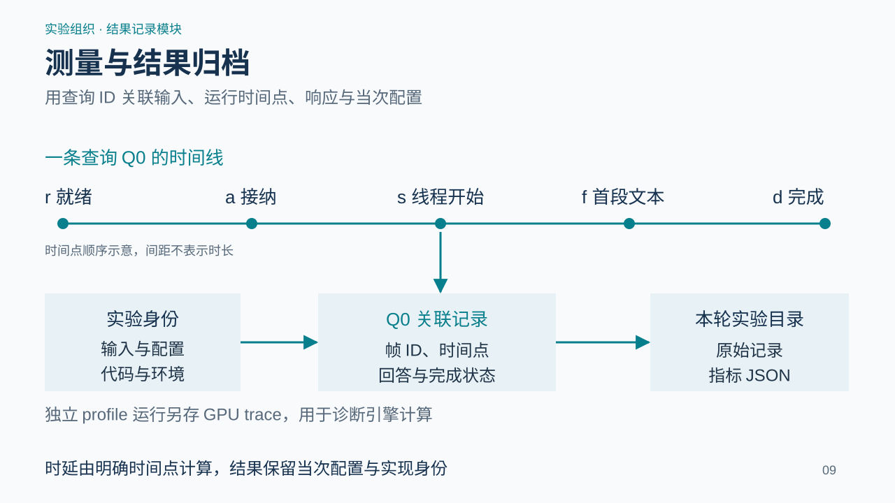
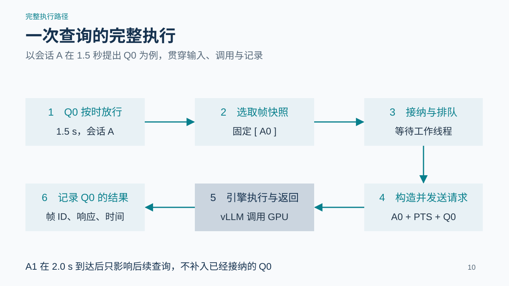

# StreamVLM 实验管线设计

本管线以图像与事件清单为输入，在 CPU 上执行回放、会话管理、请求提交和实验记录，调用推理引擎在 GPU 上运行模型。以下按总图、模块展开和完整执行路径说明最终设计。

## 1. 管线总体设计

系统由输入、Python 管线和推理引擎三部分构成。输入提供图片及带时间的事件。管线内部依次完成事件回放、会话状态维护和请求提交，结果记录模块收集响应与运行信息。推理引擎独立运行，负责模型加载和 GPU 计算。该边界使输入协议和测量方式可以保持稳定，同时更换被测引擎实现。

**设计规则：**管线负责实验控制；模型计算由推理引擎在 GPU 上执行。

## 2. 输入协议

执行入口是图像文件与 JSONL 事件清单。frame 事件指向图片，并记录会话、来源时间和就绪时间；query 事件记录问题文字、就绪时间和证据截止时间。所有事件都有唯一 ID，清单按 ready_ms 排序。同一来源视频可以通过不同事件清单生成不同到达和提问安排。当前视频抽帧属于输入准备步骤。

**设计规则：**frame 和 query 是主数据事件；cancel 与 close 负责控制请求和会话。

## 3. 事件回放

realtime 模式以本轮回放起点为时间原点，等待到 ready_ms 后处理事件。以 1.5 秒为例，A0 与 Q0 已经放行，2.0 秒的 A1 仍在待到达区。即使 A1 图片已经存在于硬盘上，也不会提前加入会话。fastest 模式不等待名义时刻，不将其结果解释为实时响应延迟。

**设计规则：**realtime 按相对时间放行；fastest 保留事件顺序，用于快速功能检查。

## 4. 会话状态与查询快照

会话状态按 session_id 隔离。查询从已保留历史中选取满足 capture_end ≤ evidence_cutoff 且 frame.ready ≤ query.ready 的帧，形成固定快照。例子中，Q0 在 1.5 秒查询会话 A，因此得到 A0，不得到会话 B 的 B0，也不得到尚未到达的 A1。full 与 recent 策略控制历史保留，recent 丢弃的帧会记录 ID。

**设计规则：**仅选同会话且满足截止时间的帧；新帧不会补入已经接纳的查询。

## 5. 请求接纳与并发

每次请求由固定帧快照和当前问题组成。接纳前检查 pending_capacity；预算不足则明确报错，不静默丢弃。接纳后进入线程池，最多 concurrency 个工作线程执行后端调用。请求在完成、失败或取消后释放预算。客户端线程并发和 vLLM 内部 GPU 批处理分别由两侧控制。

**设计规则：**pending_capacity 包含排队与执行中的请求；concurrency 限制工作线程数。

## 6. 推理后端接口

后端适配器接收帧快照与问题，构造请求并读取响应。当前主路径使用本机 vLLM 的 OpenAI-compatible 接口，每次发送历史图片、source PTS 文本标签和当前问题，读取 SSE 文本及完成标记。返回内容统一为回答、完成原因、可选 token 用量与请求标识。相同控制逻辑也可以通过 native 适配器调用 Transformers 参考实现。

**设计规则：**当前 HTTP 路径重发保留的历史图片前缀，不保证跨查询持续 KV 复用。

## 7. 服务生命周期

managed 实验首先读取引擎环境、模型目录、GPU 和启动参数，检查端点与资源，启动自己的服务进程组。模型加载由引擎完成，管线等待服务就绪后才建立回放时钟。完成或异常退出后，归档日志并结束自有服务。因此模型启动阶段和请求测量阶段具有明确边界。

**设计规则：**只管理本轮启动的服务；启动或执行异常也进入收尾流程。

## 8. 实验配置与批量运行

配置分为输入条件、客户端控制和被测引擎三组。输入条件指定清单和历史保留；客户端控制指定回放、线程并发及在途预算；被测引擎指定模型、环境、GPU 与启动参数。suite 顺序执行命名 case，每个 managed case 管理一次服务生命周期，并区分预热与正式重复。workload 工具可复制会话并改变到达错开。

**设计规则：**每轮使用独立输出目录；预热单独保存，同一 case 内重复可能保留引擎缓存。

## 9. 测量与结果归档

每个 query_id 关联帧来源、接纳、线程开始、首段文本和完成时刻。由此计算客户端接纳延迟、排队、首段文本与完成延迟。实验目录同时保存原始时间线、回答状态、配置、输入与源码身份、设备采样；独立 profile 运行保存引擎 GPU trace。客户端排队不是引擎内部排队，SSE 块间隔不是 token 间隔。

**设计规则：**客户端测量与 GPU 诊断分开解释，所有结果保留当次配置和实现身份。

## 10. 一次查询的完整执行

Q0 在 1.5 秒由回放器放行。会话状态选出 A0，并固定快照；A1 要到 2.0 秒才可用，不参与 Q0。请求模块检查预算并安排工作线程，适配器把 A0、时间文字和问题发给 vLLM。引擎在 GPU 上执行后返回回答，记录模块把 Q0、A0、响应时间和配置一起保存。这条路径构成管线的主要执行流程。

**设计规则：**同一查询的证据在接纳时固定，并一直关联到最终结果。

## 实现对应

| 设计职责 | 实现入口 |
|---|---|
| 输入校验、会话与快照 | events.py |
| 回放、预算、线程与时间线 | runner.py |
| 请求与响应适配 | backends.py、native.py |
| 服务生命周期 | deployment.py、cli.py |
| 工作负载与实验套件 | workloads.py、suite.py |
| 结果指标与身份记录 | report.py、identity.py |

文中图示反映当前实现。主计算路径为本机 vLLM HTTP 服务；当前输入为帧与文字问题，采用历史图片前缀重放。
