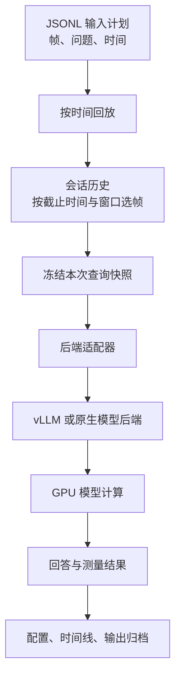

# 管线设计

管线把固定输入计划变成可复现的推理实验。模型计算由后端执行；修改引擎后，仍可使用相同输入和测量方法比较。

## 一次查询如何执行



服务启动和停止属于外层实验管理。运行阶段可以回放多轮输入，每轮可以包含多个会话和查询。

| 职责 | 主要代码 | 具体做什么 |
|---|---|---|
| 输入与会话 | `events.py`、`runner.py` | 按事件时间放行、维护帧窗口、冻结查询快照 |
| 引擎调用 | `backends.py`、`native.py` | 把帧与问题转换为后端输入，接收输出 |
| 服务生命周期 | `deployment.py` | 检查资源、启动指定引擎、等待就绪、回收自己的进程 |
| Serving | `serving.py`、`nccl_connector.py` | 接纳与排队、选择实例、协调标准 PD、审计传输 |
| 压测与测量 | `stress.py`、`stress_metrics.py`、`report.py` | 构造到达负载、记录失败与延迟、汇总结果 |
| 多组实验 | `suite.py`、`identity.py` | 执行配置组、记录实现与输入身份 |

## 管线、网关和引擎

```text
管线：组织输入和实验，记录结果
   ├─ 直接调用一个后端
   └─ 调用 Serving 网关
          ├─ 调用一个／多个普通 vLLM 实例
          └─ 依次调用 P、D 实例；connector 搬运 KV

vLLM：管理模型执行、请求调度与 GPU 模型缓存
```

网关传请求和控制信息，KV 不经过网关。当前同机 NCCL 通路为 P 显存 → 主机共享内存 → D 显存。

## 当前输入语义

- 查询只使用截止时间之前已就绪的帧，帧与问题组成固定输入快照。
- 生成期间到达的新帧归入后续查询，不改变当前回答输入。
- `recent` 窗口限制后续请求携带哪些旧帧，不等同于在引擎内部删除历史 KV。
- 普通 HTTP 请求提交完整快照，不保证跨请求持久 KV 复用或增量 prefill。

更换模型需要匹配后端能力与模型格式，不是所有模型只改名称即可运行。验证范围见[状态](status.md)。
