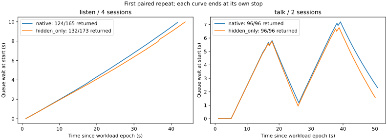

# Venus 共置基线加强：重复投影清理结果

已完成一项原生执行清理，并通过输出核验和成对压力复测。它减少不使用的词表投影，不改变权重、精度、输入单元、因果顺序、KV 或采样规则。**仍按完整输入单元串行执行，尚不是优化批处理系统，也不是 PD。**

## 修改与正确性

- [具体执行差别与复现方法](venus-baseline.md)：直接使用相同 Transformer 主体，只在需要词表分数时计算一次；保留原矩阵形状。
- 两版本各完整执行 188 单元；再做 432 单元的连续／交错会话检查，共 808 单元核验通过。完整输出签名和指定单元抽查 KV 一致，连续 A/B 也匹配上一轮未修改的原生记录。
- 完整 188 单元中，词表投影调用由 1,836 次降至 448 次，减少 75.6%。调用次数减少不等于端到端加速。
- 处理输入前的模型加载、准备和视频提取不计入性能收益；投影计数 hook 在压力测量前移除。

## 对比条件

两张新选择的空闲 RTX 3090，一卡放主体、一卡放波形；所有本轮原生／改进对比使用同一对卡、同一模型进程和共享权重。每侧独立重置会话状态。没有直接拿上一轮不同时间／选卡的结果计算加速比。

4 会话无额外问题、2 会话带问题各做三对 48 单元运行，交替先后顺序；另做一对 108 单元单会话运行。每会话每秒一个输入，错峰到达，不等计算完成再发送。队列、10 秒等待上限与 22 GiB 已分配显存门槛沿用上一轮。资源监测未观察到其他计算进程占用所选 GPU；主机仍是共享机器。

## 实测结果

“完成／已到达”包含运行停止时的未完成项。最大排队只来自已完成单元，提前停止的运行仍有截断。“调用均值比”在两侧都完成的相同输入上匹配，排除每会话前四单元，用原生均值除以改进均值；大于 1 表示该项调用墙钟缩短，**不是 GPU 吞吐或完整返回加速比**。

| 负载 | 原生完成／已到达 | 改进完成／已到达 | 最大排队：原生／改进，秒 | 匹配调用均值比 |
|---|---:|---:|---:|---:|
| listen／4会话／第1对 | 124/165 | 132/173 | 9.926 / 9.986 | 1.019 |
| listen／4会话／第2对 | 125/166 | 134/175 | 9.926 / 9.972 | 1.020 |
| listen／4会话／第3对 | 125/166 | 132/173 | 9.930 / 9.969 | 1.015 |
| talk／2会话／第1对 | 96/96 | 96/96 | 7.199 / 6.772 | 1.017 |
| talk／2会话／第2对 | 96/96 | 96/96 | 7.360 / 6.680 | 1.024 |
| talk／2会话／第3对 | 96/96 | 96/96 | 7.259 / 6.723 | 1.017 |
| talk／1会话／108单元 | 108/108 | 108/108 | 0.162 / 0.209 | 1.148 |

六个短时成对比较的调用均值比范围为 1.015—1.024。不把逐输入样本当成独立重复来给出虚假的置信区间，也不把这项局部收益外推成完整服务容量提升。

108 单元单会话只有一对，其 1.148 比值明显高于短时重复范围。尚未区分历史长度、运行顺序、设备频率或主机波动的作用；保留该观测，但不据此报告可复现的 14.8% 普适加速，需要另行重复验证。

图仅展示各负载的第一对，每条曲线到其自身停止为止。表中所有重复单独报告。若两侧停止时间不同，原始完成数和排队分位数不能直接当成相同观测时长的比较。

14 组总计划 1,944 单元；到各次停止时已到达 1,810，完成 1,564，已到达未完成 246，另有 134 尚未到达。所有组发送端与实际说话负载资格检查通过；每对匹配输入的输出签名再次检查通过。

为了公平处理截断，[聚合数据](../data/venus-baseline.json)还按两侧较短的共同观测时长重算完成量及 0.5／1／2 秒期限达成；未完成项留在分母中。期限只是整单元返回诊断阈值，没有验证实际播放器或应用 SLO。

## 如何使用这个结果

这项清理可以作为后续基线的显式选项，避免把消除重复投影本身算成 PD 创新。原生路径保留可复测。无论局部调用节省多少，整单元串行、跨会话批处理不足及主机提交间隙仍然存在，当前没有证明硬件已饱和。

下一门槛是更细执行粒度／合理批处理的共置基线及较长多会话负载，再做等资源 PD 对照。单次 108 单元单会话运行不能代替长期多会话稳态；固定两个视频片段、同一声音、窗口关闭、共享主机和部分顺序平衡仍限制外推。

## 证据

- [实现与运行](venus-baseline.md)、[固定计划](../../configs/venus/baseline-comparison.json)、[全部聚合数值和源码哈希](../data/venus-baseline.json)。
- 源码与配置匹配冻结执行记录；压测代码继续复用上一轮的发送和计时实现。
- 15 项 Venus 相关回归检查通过。私有归档逐文件校验通过，包含运行源码、原始输出、停止记录、资源监测和分析；公开仓库只保留实现、配置、聚合结果和图。
