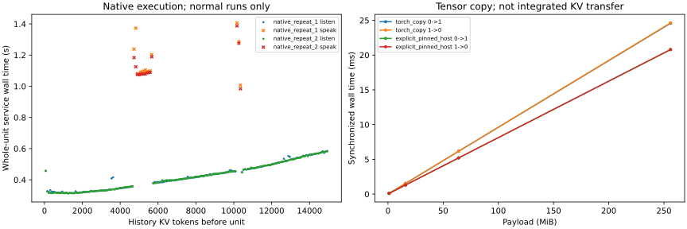

# Venus 阶段 0／1：审计与单会话定位

本轮已完成计划冻结、历史记录审计、传输微测试、两次原生复测和一段新的长历史 trace。未实现新的 PD，也未测定多会话容量。

## 条件与正确性

- 载体：官方 Venus 原生逐秒推理，同一段 188 单元视频与原始问题计划。
- 部署：两张 RTX 3090；主体模型与同步波形模块分卡，语言模型 P／D 同卡。
- 环境：PyTorch 2.4.1+cu121，CUDA 12.1。模型和预处理、采样、窗口语义保持原配置。
- 核验 85 个 checkpoint 文件和 7 个运行时源码文件，全部匹配之前冻结的下载记录；这不是重新核验上游最新 revision。
- 三次新增运行均处理完 188 单元，文字、控制标记、token 数、音频哈希和最终 KV 长度与参考逐单元一致。
- 本地回归：45 项检查，44 通过，1 项 Linux 进程组检查在 Windows 跳过。

## 正常复测

| 运行 | 输入单元 | 倾听单元平均服务时间 | 说话单元平均服务时间 | 最终 KV token 数 | 输出签名 |
|---|---:|---:|---:|---:|---|
| native_repeat_1 | 188 | 0.424 s | 1.156 s | 15017 | 一致 |
| native_repeat_2 | 188 | 0.422 s | 1.125 s | 15017 | 一致 |

服务时间是一次 prefill＋generate 完整返回的主机墙钟时间，包括相关编码与语音路径；不是纯语言模型时间、首 token 延迟或物理播放延迟。每轮包含 173 个倾听单元、15 个说话单元。仅两次新增正常复测，不据此给出普适置信区间。

横轴历史长度与视频时间共同变化。倾听时间随历史区间增加的现象值得后续控制变量验证，不能把整条曲线完全归因于 KV 长度。

## GPU trace 定位

- 复用已有第 55—76 单元的 trace，覆盖说话阶段；语言模型相关 kernel 时长占所有记录 kernel 时长之和约 71.7%。
- 新采第 165—176 单元，均为长历史倾听；相同比例约 89.0%。
- 归属基于启动 CUDA API 的 correlationId 和所在 NVTX 调用范围，而不是仅按时间重叠猜测。
- 上述比例是 kernel 时间构成；跨卡 kernel 求和不是端到端耗时。trace 的主机提交与同步活动也不能直接与 GPU 时间相加。
- 尚无硬件计数器证据，不能据此断言 memory-bound、compute-bound 或实际 SM 占用饱和。

## 两卡传输条件

本次设备通过 PCIe 相连，PyTorch 报告双向 peer access 为 false。不能假设 NVLink；默认复制的物理中转路径未通过独立传输 trace 逐段确认。

每点预热 2 次、计时 9 次并验证数据内容。下表为 256 MiB 的同步墙钟中位数，逻辑 0／1 是本次选卡后的相对编号：

| 方法 | 方向 | 中位数 |
|---|---|---:|
| torch_copy | 0 → 1 | 24.57 ms |
| explicit_pinned_host | 0 → 1 | 20.78 ms |
| torch_copy | 1 → 0 | 24.62 ms |
| explicit_pinned_host | 1 → 0 | 20.80 ms |

这是独立缓冲区复制，不包含 KV 分块协议、序列化、排队与跨进程握手。不能直接称为真实 PD 的 KV 传输性能，也不能将显式主存中转在本微测中的结果当作新优化贡献。

## 已有数据的使用边界

历史审计保留了零单元失败运行，未覆盖或删掉失败记录。已完成运行的单元顺序、因果时间与延迟分解检查通过。

`fastest` 模式把全部输入尽快释放，其排队时间不作为真实时间到达下的稳态过载结论。窗口 on/off 改变保留历史，也不能直接报告成等语义加速。W2／W3 需要沿用原来的实际负载资格检查。

## 阶段判断与下一门槛

1. 语言模型执行是值得继续测量的主要组成部分；尚未证明 PD 有净收益。
2. 历史增长、状态放置和 PCIe 交接成本需要进入后续成本模型。
3. 当前不能从单会话结果推算多用户容量。原生模型上的音频缓存等存在共享可变状态；仅新建两个 Duplex 对象或增加线程不足以保证会话隔离。
4. 阶段 2 先审计并隔离语言 KV、音频、TTS／波形、控制标记和 RNG，再建立合理调度／批处理的共置基线，随后执行开放式递增压力。

数据入口：[精简数值](../data/venus-characterization.json)。方法与阶段门槛：[执行计划](venus-characterization.md)。原始运行、失败、逐单元日志和大 trace 在实验归档中独立保存，不提交 Git。
