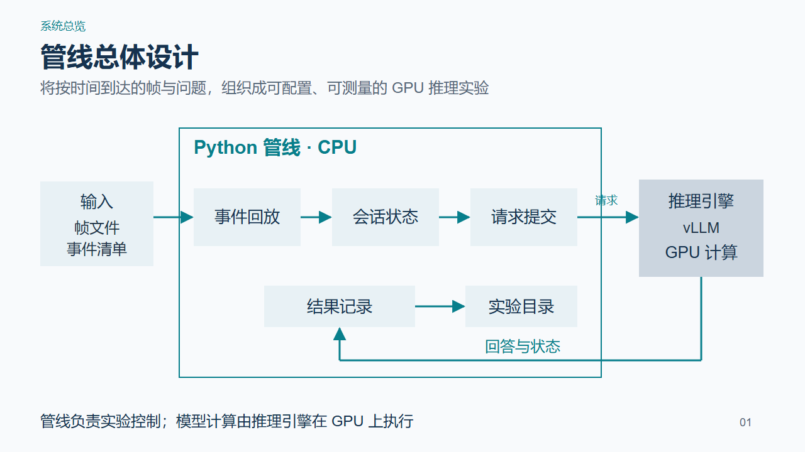

# StreamVLM 管线设计

现场汇报请使用 [八页汇报版](../pipeline-talk/README.md)。本目录保留较早的十页图解及其源文件。

本目录面向组内设计汇报，按系统总览、模块展开、完整查询路径组织。

- [汇报 PPT](StreamVLM管线设计.pptx)：10 页，每页一张主图，图形和文字可编辑，附逐页讲稿备注。
- [管线设计图解](管线设计图解.md)：使用与 PPT 一致的十张图，逐图说明模块职责、输入输出与设计规则。[浏览器阅读版](管线设计图解.html) 可下载后直接打开。
- [逐页讲稿](逐页讲稿.md)：对应十页 PPT，建议汇报约十二至十五分钟。[浏览器阅读版](逐页讲稿.html)。
- [全部页面预览](PPT预览.html)：下载后使用浏览器打开。

## 内容层次

1. 系统总览：输入、CPU 管线、推理引擎和 GPU 之间的关系。
2. 输入与状态：输入协议、事件回放、会话状态与查询快照。
3. 请求与执行：接纳预算、并发、后端接口与服务生命周期。
4. 实验组织：配置、批量运行、测量与结果归档。
5. 完整路径：用会话 A 的同一个查询贯穿执行过程。

## 设计依据与图源

图示对应仓库当前 Python 实现：`events.py`、`runner.py`、`backends.py`、`native.py`、`deployment.py`、`suite.py`、`identity.py` 和 `report.py`。图中的时间为输入示例，非实测性能。当前主路径按图片与文字构造本机 vLLM 请求，使用历史前缀重放。

`图源/` 保存手工编写的 SVG 页面和设计约束。`content.json` 保存逐页说明与讲稿。`build_materials.py` 用于组织说明和核对导出文件。`交付核对.json` 记录逐页文字与备注的一致性和文件哈希。

PPT 通过 [PPT Master](https://github.com/hugohe3/ppt-master) 的原生 DrawingML 导出工具制作，工具版本为 `e2820d326d049f1fcbe90523983def3d52280233`。打开成品无需安装该工具。
