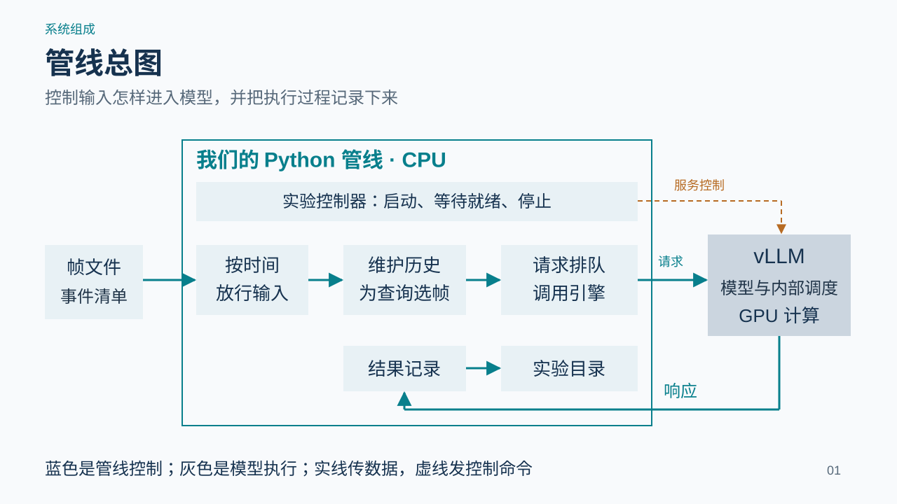
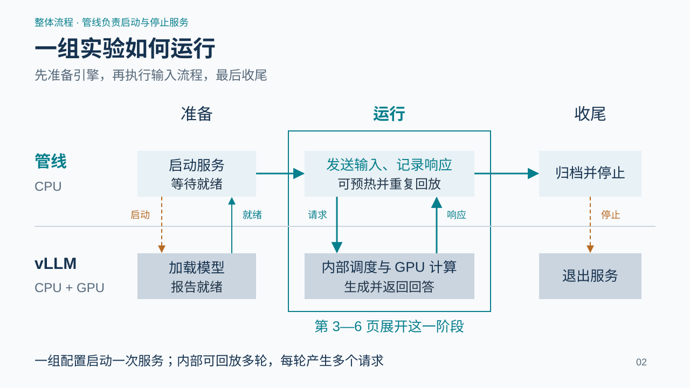
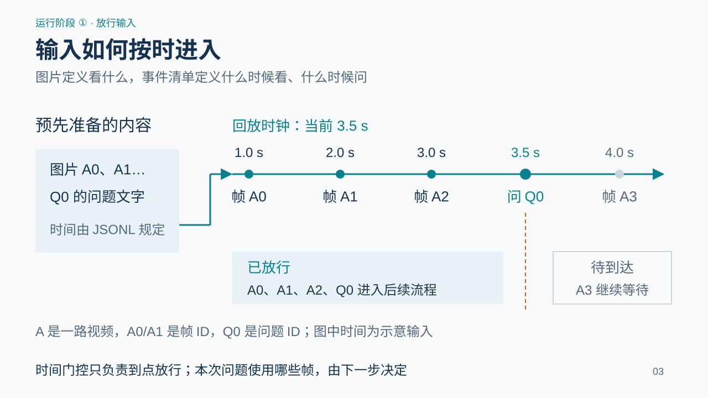
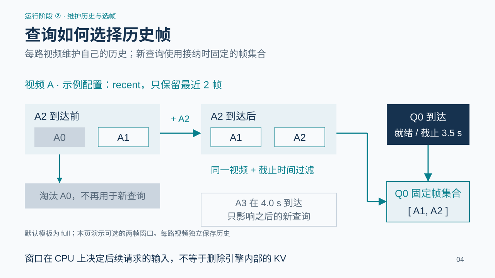
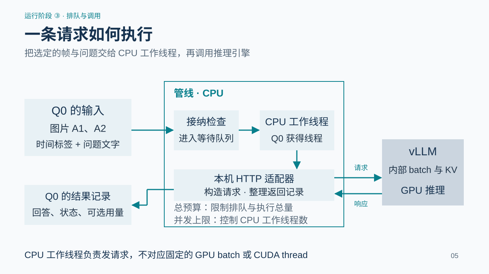
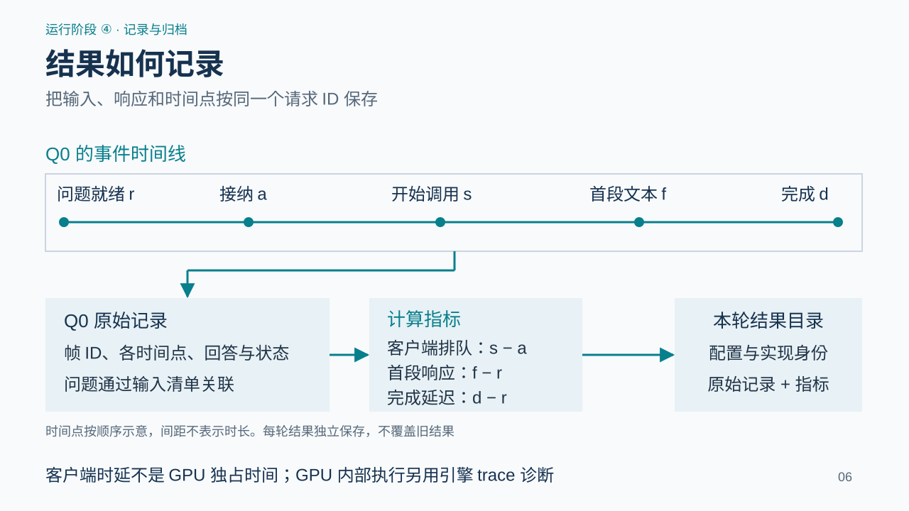
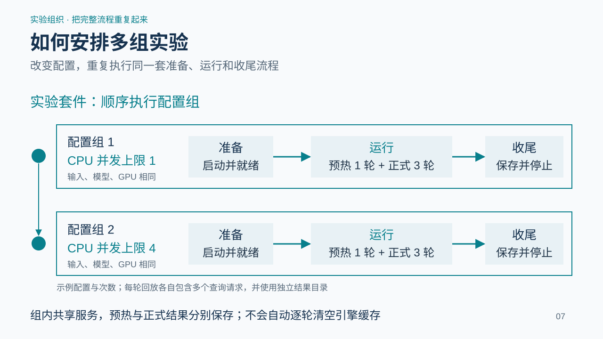
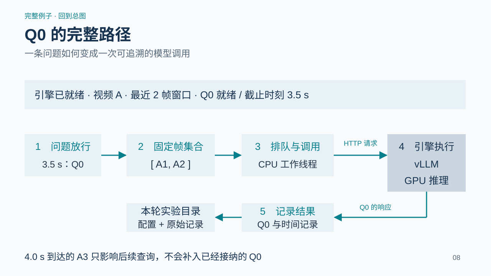

# StreamVLM 实验管线设计

本管线在 CPU 上控制输入、维护视频历史、提交请求并记录结果；独立运行的 vLLM 调用 GPU 执行模型。本文先说明整体层次，再展开运行阶段。

**层次约定：**实验套件包含多个配置组；每个托管配置组启动一次引擎服务，运行阶段可回放多轮；每轮回放产生多个查询请求。图中的时间、两帧窗口和重复次数均为设计说明示例，不是性能测量。

## 1. 管线总图

图的左侧是预先准备的图片与事件清单，中间是运行在 CPU 上的 Python 管线，右侧是独立运行的 vLLM 服务。管线按时间放行输入，为每路视频维护历史，再把选好的帧和当前问题组成请求。vLLM 负责模型执行与 GPU 调度；回答返回管线后，与输入、时间和配置一起保存。实验控制器包在这条运行流程外面，负责启动、等待就绪和停止服务。

**设计规则：**蓝色区域是管线；灰色区域是 vLLM 与 GPU。两边通过请求和响应连接。。

## 2. 一组实验如何运行

在管线负责启停服务的托管模式下，一组配置对应一次引擎服务生命周期。管线发起启动命令，vLLM 加载权重并提供服务；管线检查就绪后才开始回放。运行阶段可以包含预热与多次正式回放，每次回放又产生多个查询请求。结束后，管线汇总记录并终止本组自有服务。图采用双泳道，分别标明管线和引擎的动作。异常也进入收尾流程。

**设计规则：**第 3—6 页展开中间的运行阶段；模型加载和 GPU 计算都由 vLLM 执行。。

## 3. 输入如何按时进入

输入分为内容文件和时间清单。图片提供视觉内容，query 提供问题文字。事件清单按 ready_ms 排序，规定每项输入何时交给下一步。贯穿本文的示意输入是：1.0 秒 A0，2.0 秒 A1，3.0 秒 A2，3.5 秒提出 Q0，4.0 秒 A3。A 表示一路视频，A0/A1 等为其中帧的 ID，Q0 是一次提问的 ID。执行端不会提前把待到达图片送进模型。

**设计规则：**时间门控只负责到点放行；哪些历史帧用于提问，由下一步决定。。

## 4. 查询如何选择历史帧

本页示例显式使用 recent、max_frames=2。在 A2 到达前，历史为 A0、A1；A2 加入后淘汰 A0，历史变成 A1、A2。Q0 在 3.5 秒到达，选取同一视频流中满足证据截止时间的帧，并固定为 A1、A2。A3 在 4.0 秒到达后只影响之后的查询，不再补入 Q0。其他视频流维护独立历史。当前默认模板使用 full；recent 是已有的可选策略，只按帧数保留，未实现按秒淘汰或持续 KV 淘汰。

**设计规则：**窗口在 CPU 上控制后续请求的输入；不等于淘汰引擎内部的 KV。。

## 5. 一条请求如何执行

Q0 的输入为固定帧 A1、A2 和当前问题文字。管线先检查排队与执行中的总请求预算，接纳后交给 Python 线程池。CPU 工作线程通过 HTTP 适配器调用本机 vLLM。发送内容是图片、逐帧 source PTS 文字标签和当前问题，并非完整对话历史。vLLM 自行组织内部 batch、管理 KV 并执行 GPU 计算。适配器接回文本流并整理为回答、状态、结束原因及可选用量等记录。当前采用历史图片前缀重放，不保证跨查询持续 KV 复用。

**设计规则：**CPU 请求并发与引擎内部 batch 是不同控制；一次请求不等于一个 CUDA thread。。

## 6. 结果如何记录

Q0 的记录包含帧 ID A1/A2、回答和完成状态，以及名义就绪、接纳、开始调用、首段文本和完成时刻。问题文字通过输入清单路径、查询 ID 和清单校验值关联，不在每条结果中重复存储。客户端排队时间由开始调用减接纳得到；从就绪到首段文字及到完成的延迟分别单独统计。每轮回放使用独立输出目录，同时保存实际配置、输入哈希和实现身份。设备采样与独立 profiling trace 是补充诊断数据，不能把客户端等待或 SSE 文本块间隔直接称作 GPU 时间或 TPOT。

**设计规则：**客户端时延包含排队和传递等影响；GPU 内部执行另用引擎 trace 诊断。。

## 7. 如何安排多组实验

实验套件顺序执行多个命名配置组。示例中，第 1 组与第 2 组使用相同输入、模型和 GPU，仅将 CPU 请求并发上限从 1 改为 4。每组都执行第 2 页的准备、运行、收尾流程；运行阶段可先预热一轮，再正式重复三轮。每轮产生独立结果目录。同组重复共享服务，因而缓存状态可能延续。输入、客户端控制、模型与引擎、部署、重复安排和实现追溯是配置的不同层次。

**设计规则：**同一配置组内共享服务，预热与正式回放分别保存；不会自动逐轮清空缓存。。

## 8. Q0 的完整路径

回到同一个示例。引擎已经就绪，3.5 秒 Q0 被放行。视频 A 的两帧窗口留下 A1、A2，管线固定这组证据并接纳请求。CPU 工作线程向 vLLM 发送图片、时间文字与问题，vLLM 在 GPU 上执行并返回响应。管线以 Q0 为键保存输入、状态和时间。4.0 秒的 A3 不补入 Q0。这个例子串起总图中的四项管线职责，同时保留引擎与 GPU 的独立边界。

**设计规则：**一组实验包住多轮回放；一次回放产生多个请求；Q0 的证据固定为 A1、A2。。

## 实现对应

| 设计职责 | 实现入口 |
|---|---|
| 输入校验、会话与快照 | events.py |
| 回放、预算、线程与时间线 | runner.py |
| 请求与响应适配 | backends.py、native.py |
| 服务生命周期 | deployment.py、cli.py |
| 工作负载与实验套件 | workloads.py、suite.py |
| 结果指标与身份记录 | report.py、identity.py |

文中图示反映当前实现。主计算路径为本机 vLLM HTTP 服务；当前输入为帧与文字问题，采用历史图片前缀重放。
