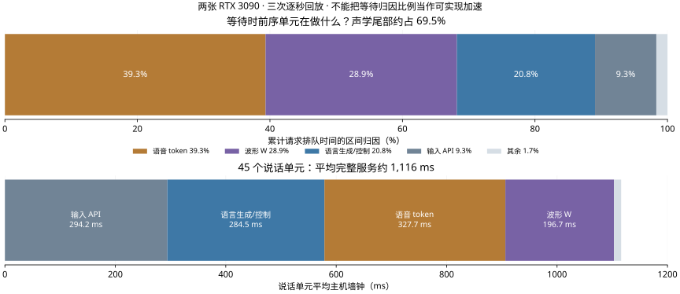
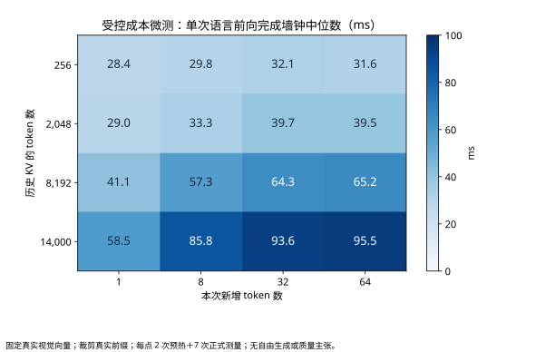

[Venus 主线](../README.md) · [方法与范围](../bottleneck-attribution.md)

# 先定位 P/D、语音 token 与 W：本轮结果

本轮完成三次逐秒回放，共 564 单元；另有 304 单元计时开关校准、188 单元完整预热、188 单元微测前缀，共 1,244 个原生单元。固定状态成本微测有 16 个形状组合、112 次正式测量与 32 次预热。没有实现 PD、主动切分或复制/重建优化。

## 条件与核验

- 两张 RTX 3090：主体卡负责编码、语言 P/D 与语音 token，另一张卡负责波形 W。BF16、SDPA，沿用已核验的重复投影清理路径，关闭视觉合并。
- 同一 188 单元音视频，每秒一帧与约一秒真实声音。第 60/128 单元以文字加入官方问题，不是连续用户语音或独立多视频压力集。
- 所有原生单元匹配冻结参考签名：文字、控制、token 数、波形哈希和 KV 长度；不等于完整 KV 逐字节比较或任务质量评估。到达来源 P95 迟到小于 0.2 ms。
- 两对开关校准的平均服务变化为 +0.049%、+0.462%；只能说明本次未见很大的观察开销，不是精确工具成本置信区间。
- 首个尝试因新增计时包装的函数绑定错误失败；失败记录保留，修复并加回归测试后新建目录重跑，失败样本不纳入结果。

## 逐秒到达结果

下表单位为秒。完整返回延迟从输入计划可用时刻计，包含排队、编码、语言与声音准备，不是实际播放首声。

| 重复 | 完整返回 P95 | 最大排队 | 说话单元 |
|---|---:|---:|---:|
| realtime_r0 | 1.595 | 1.076 | 15 |
| realtime_r1 | 1.494 | 0.944 | 15 |
| realtime_r2 | 1.672 | 1.293 | 15 |

三次都完成 188 单元且无丢弃。说话单元合并平均服务约 1.116 秒；倾听平均约 0.454 秒。与以前批次的差异不是新方法加速：没有做任何执行优化，不能跨批次相除报告收益。

## 排队区间与哪段工作重叠

对每个输入从入队到开始的等待区间，与前序工作的非重叠主机阶段相交并对账。累计请求等待 32.604 秒，其中语音 token 39.34%、W 28.88%、语言生成/控制 20.85%、输入 API 9.26%，其余约 1.68%。多个请求的等待可重叠，累计值不是程序墙钟可删除时间。

说话单元的阶段墙钟均值为：输入 API 294.2 ms、语言生成/控制 284.5 ms、语音 token 327.7 ms、W 196.7 ms。输入 API 含编码/预处理；语言范围含采样、控制和提交等待，不能统称为纯 P/D GPU kernel 时间。

GPU 流事件另显示：前一说话单元语言状态达到事件点、且下一输入已可用之后，下一次输入 API 流事件仍有约 506 ms 的中位间隔。时钟锚点最大不确定区间约 0.118 ms；这是 API 入口事件，不是注意力 kernel 开始，也不是可直接删除的等待。

这支持把语音 token 与 W 纳入瓶颈分析，但不证明移卡/异步必然加速。此前 W 重叠收益不稳的限制仍然存在；本轮没有消除资源竞争、线程或声学状态管理问题。

## 固定状态微测：历史长度确实改变本次计算代价

从第 188 单元抓取真实 64×4096 视觉向量和 14,940 token 的真实历史，裁剪前缀并固定输入子区间，每次独立恢复缓存；恢复与上传不计入前向时间。它是人为控制形状的成本探针，不是可用于问答的历史压缩或质量优化。

历史从 256 增至 14,000 token 时：1 个新增 token 的完成中位数由 28.4 增至 58.5 ms；64 个新增 token 由 31.6 增至 95.5 ms。说明历史访问/计算规模值得进入成本模型，尚不能凭此判断 HBM 带宽或算力是否饱和。

## 显存与资源

本批完成且未发生 OOM，未观察到其他进程使用所选 GPU。10 秒采样所见实际占用最大值：主体 21,298 MiB、W 8,052 MiB；采样峰值是瞬时峰值的下界，不是 PyTorch 已分配峰值。实验进程已释放。

两卡完成不证明完整三卡 PDW 已可用。三卡须分别验证权重、副本 KV、临时工作区与语音状态，并固定同总资源预算；W 不是语言 KV 的另一个接收者。

## 三卡前置检查：驻留与单步语言计算通过，服务协议未实现

在三张 RTX 3090 上：先用主体卡与 W 卡执行完整 188 单元，输出签名全部匹配参考；将已有语音 token 权重移到候选 D 卡，构造独立语言副本，复制 15,017 token 的完整语言 KV，并完成一次相同输入的语言前向。

修复后的源模型/副本 logits 最大差为 0，argmax 相同。三卡 PyTorch 已分配显存峰值约 21.32 / 18.20 / 7.28 GiB，全部完成且无 OOM。第一卡峰值包含审计保留旧前缀所产生的临时副本，不是精简 P 阶段所需显存。

首次预检虽然显存可用，但 logits 相对 L2 差异约 8.27%，不能作为正确交接证据。原因是 meta 副本整体转 BF16 时，旋转位置编码的 FP32 缓冲区也被转换；state_dict 不覆盖全部非持久张量。恢复源 dtype 与普通 tensor 别名、增加回归和数值门槛后，新目录重测通过。首次记录保留。

这里只验证内存与单步语言计算，**没有验证语音模块迁移后的前向、实时 KV 交接协议、并发、音频连续性或 PDW 净收益**。不能把它称作完整 PDW 服务跑通。入口：[pdw_feasibility.py](../../../scripts/venus/pdw_feasibility.py)。独立预检归档 SHA256：`18a7a72e4cb934aafbe57b53adc0b7892aa4d87db42c20fc58b3257df01154d2`。

## 后续实验顺序

1. 三卡前置检查已完成驻留与单步语言验证；下一门槛是语音迁移后的执行状态和最小实时交接协议，不直接宣称服务 PDW。
2. 同资源声学路径隔离：保持模型和负载，区分语音 token、W、提交/等待干扰；重复已有 W 对照，不能根据本轮比例预报收益。
3. P/D 局部机制：固定同一历史与 token，测真实 KV 布局复制/安装和 P 重建，再决定是否做联合策略。
4. 主动切分：先测合法更早边界与续说/声音效果；只有端到端和效果都通过，才与 PD/W 组合。每项比较都保留原生、单项及简单组合。

[聚合数据与哈希](../../data/venus-bottleneck-attribution.json) · 原始记录与失败尝试保存在私有归档；归档 SHA256：`5960458a0f5c649b7443b603aac5a8b504d0528841bd7319d22e712c1a4bd6b4`。
