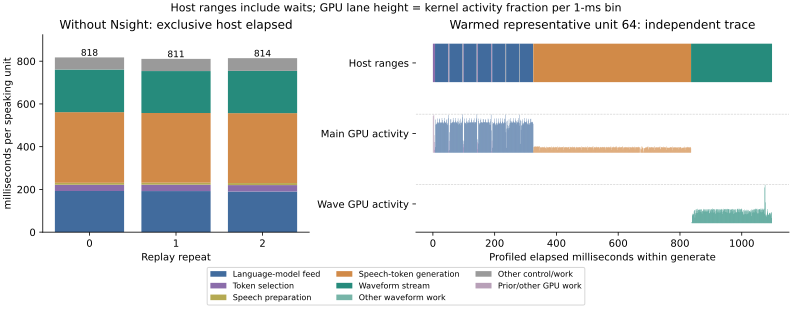

[Venus 主线](../README.md) · [测量方法](../generate-breakdown.md)

# 说话时，生成接口内部在做什么

完整预热 188 单元后，无 Nsight 测三遍共 564 单元，其中 45 个说话单元。另一个进程重新完整预热，再执行正确前缀，独立采第 55—76 单元（22 单元，12 个说话）。全部输出匹配冻结参考。

说话时生成接口均值约 814 ms：语言模型 feed 约 192 ms，语音 token 约 328 ms，底层波形约 198 ms。后两项合计约占 65%。这是包含等待的主机范围；不能把语音 token 的 328 ms 全部解释为 GPU 计算或 CPU 开销。独立 trace 中该范围有明显执行间隙，值得进一步定位提交和同步。

## 无 Nsight：主机范围计时

下表扣除了嵌套子调用，所有行可以相加还原生成接口的平均墙钟。它们包含 GPU 提交与等待，不是纯 CPU 运算时间。

| 工作范围 | 倾听时平均 ms | 说话时平均 ms |
|---|---:|---:|
| 语言模型 feed | 59.27 | 191.74 |
| token 选择／采样 | 24.91 | 29.73 |
| 语音条件准备 | 0.00 | 9.29 |
| 语音 token 生成 | 0.00 | 327.93 |
| 底层波形 stream | 0.00 | 197.75 |
| 波形接口其他工作 | 0.00 | 0.09 |
| 剩余控制／未包围工作 | 13.97 | 57.69 |
| **生成接口合计** | **98.15** | **814.22** |



左图是三次无 Nsight 测量的说话单元均值。右图是独立 profile 中第 64 单元的一次生成调用，不能拿其横轴当作正常耗时；GPU 每个 1 ms 小格的高度表示其中有 kernel 执行的时间比例，虚线对应 100%；颜色为该格主要组件，紫灰色包括前一输入阶段延续的工作。它不是 SM occupancy，也不把微小执行间隙抹成连续忙碌。主机等待期间仍可能存在 GPU 活动。

## 独立 trace：说话单元内的 GPU kernel 组成

仅选择捕获区间内 12 个实际说话单元的 generate 阶段。下表为每说话单元的 kernel 时长之和，不是该模块的墙钟；跨 GPU 可能重叠，不能据此直接预测加速。

| GPU | 最深标记组件 | 每说话单元 kernel 时长之和 ms |
|---|---|---:|
| 0 | component/llm_body | 225.38 |
| 0 | component/llm_head | 7.84 |
| 0 | component/sampling | 2.09 |
| 0 | component/tts_tokens | 66.26 |
| 0 | component/unattributed | 0.06 |
| 1 | component/waveform | 87.29 |

GPU 0 为主体、GPU 1 为波形。语言模型 feed 含控制标记等输入，不全是回答文字 decode；TTS、波形属于独立语音流程。trace 中 CUDA API 还包含提交和同步／拷贝，不能把全部 API 耗时当作纯启动成本。

## 下一步候选：先验证波形与后续输入重叠

源码顺序是：生成语言 token、追加 `</unit>`、登记本单元及处理窗口，然后才执行语音条件、语音 token 与波形。语言 KV 的计算依赖不要求等待最后的波形合成，但当前接口把这些步骤封装为同步调用。

```text
当前：本秒输入 → 语言生成／KV更新 → 语音token → 波形 → 下一秒输入

待验证：本秒输入 → 语言生成／KV更新 → 语音token → 下一秒输入
                                                 └→ 上一段波形
```

先只考察上一段波形与后续输入的重叠，沿用两卡预算。它不是传统语言 P/D 分离，也不是已经实现的加速。必须确认 GPU 上的数据就绪、冻结波形任务输入、隔离共享状态与随机状态、保持输出顺序；下一秒输入也必须真实到达后才能使用。先前主机范围不能直接作为可重叠的收益预测，仍需等工作量、等资源的实测和已有方法核查。

## 结论边界

应依据上述正常主机范围和独立 GPU 活动选择候选优化，不能把最大的主机范围直接认定为纯 CPU 瓶颈。kernel 活动比例不是 SM occupancy、带宽或算力饱和度。本轮没有实施 PD、没有新加速结果，也没有测音频播放或任务质量。

首个尝试在完整预热后因计时包装的闭包绑定错误退出，零个正式样本；失败记录和原源码保留。修复后在新目录重新运行，并新增原方法绑定回归检查；不将失败预热混入测量。

[完整聚合数据、时间线和哈希](../../data/venus-generate-breakdown.json) · [配置](../../../configs/venus/generate-breakdown.json) · [前一轮完整单元定位](unit-breakdown.md)
