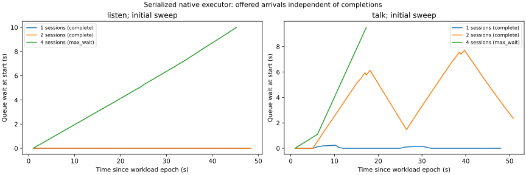

[项目首页](../../../README.md) · [Venus 主线](../README.md)

# Venus 阶段 2：会话隔离与压力初筛

本轮完成共享权重的会话状态隔离验证、14 组持续到达压力初筛、一个故意破坏隔离的负对照、两个短 GPU trace。尚未完成优化后的共置服务基线和长期容量评估，也未实现 PD。

## 实际运行了什么

沿用已冻结的官方 Venus 权重、原生 `streaming_prefill`／`streaming_generate` 计算和预处理。两张 RTX 3090 分别放主体模型和波形模块；语言模型的 prefill 和 decode 仍在同一张卡。

```text
每个会话每秒产生一个输入单元（1 帧＋约 1 秒声音＋可选文字）
                 ↓ 按墙钟到达，不等待上次计算结束
            待处理输入队列
                 ↓ 每次选一个输入单元
      恢复该会话状态 → 原生 prefill＋generate → 保存该会话状态
                 ↓
           返回该单元的文字／声音／标记
```

只有一份模型权重。会话 A、B 等各自保留语言 KV、音频缓存、波形状态、交互标记和随机状态。切换时保留 GPU 张量引用，不把整份 KV 来回搬到 CPU。这里按完整输入单元串行执行，多会话不等于 GPU 已批处理。

## 先确认会话没有混在一起

两个不同的 72 单元视频片段采用不同提问计划。先分别连续运行 A、B，再按 AB、BA 两种顺序交错运行；共执行 432 个输入单元。

- A 与原始 188 单元参考的前 72 单元一致。
- 两种交错顺序均与各自连续运行的逐单元文字、控制标记、token 数、音频长度／哈希和 KV 长度一致；模型参数存储身份未改变。
- 在指定单元抽查首／中／末层部分 KV 值，检查通过；这不是全缓存逐字节证明。
- 负对照刻意遗漏音频编码缓存的隔离。B 的首单元文字仍是倾听，但抽查 KV 已不同，说明只看文字不足以判断隔离成功。

适用范围是这两个固定片段、同一参考声音、窗口关闭和固定随机初态；没有证明任意模型、声音和输入都隔离正确。

## 压力怎样施加

1、2、4 个会话，每会话最多 48 个输入单元、每秒一个；会话之间错峰，总计划到达率分别为 1、2、4 单元／秒。输入单元不是 HTTP 问答请求，也不是一个 GPU thread。

- `listen`：不额外加入文字问题；仍记录模型实际是否说话。
- `talk`：第 5、25 单元加入简短描述问题，并用实际语音输出确认负载资格。
- 两类各粗扫 3 点，再对最高完整完成点和首次停止点各追加 2 次，共 14 组。完整完成不等于满足实时期限。
- 队列上限 256；开始计算前若计划到达已超过 10 秒，或每卡 PyTorch 已分配显存超过 22 GiB，则停止。保留已到达未完成和未来尚未到达项。
- 所有组的发送端 P95 迟到均低于预设 50 ms；发送端没有通过等待返回来降低负载。

首次压力启动在空闲检查处拒绝，尚未加载模型或发出负载；失败记录保留。等待连续空闲观测后，以相同代码与计划在新目录重试并完成。

## 结果怎样读

**排队等待**：真正入队到开始计算的时间。**完整返回延迟**：计划可用到整个输入单元处理返回的时间，包含排队、编码、语言和相关语音路径；不是首 token 或扬声器播放延迟。

表中分位数只针对已完成单元。提前停止会截断观测，所以必须一起看未完成数。分位数按各组原始记录计算，不把不同重复当成独立输入混算。

| 运行 | 完成／到停止时已到达 | 已到达未完成 | 排队 P95 秒 | 排队最大秒 | 完整返回 P95 秒 | 停止原因 |
|---|---:|---:|---:|---:|---:|---|
| listen_s1_r0 | 48/48 | 0 | 0.000 | 0.000 | 0.531 | complete |
| listen_s2_r0 | 96/96 | 0 | 0.000 | 0.000 | 0.441 | complete |
| listen_s2_r1 | 96/96 | 0 | 0.000 | 0.000 | 0.455 | complete |
| listen_s2_r2 | 96/96 | 0 | 0.000 | 0.000 | 0.347 | complete |
| listen_s4_r0 | 138/179 | 41 | 9.518 | 9.999 | 9.846 | max_wait |
| listen_s4_r1 | 129/170 | 41 | 9.419 | 9.913 | 9.751 | max_wait |
| listen_s4_r2 | 106/147 | 41 | 9.622 | 9.993 | 9.946 | max_wait |
| talk_s1_r0 | 48/48 | 0 | 0.204 | 0.238 | 1.204 | complete |
| talk_s2_r0 | 96/96 | 0 | 7.381 | 7.719 | 7.881 | complete |
| talk_s2_r1 | 96/96 | 0 | 7.387 | 7.724 | 7.886 | complete |
| talk_s2_r2 | 96/96 | 0 | 7.479 | 7.816 | 7.979 | complete |
| talk_s4_r0 | 28/70 | 42 | 8.740 | 9.513 | 9.763 | max_wait |
| talk_s4_r1 | 28/70 | 42 | 8.794 | 9.566 | 9.816 | max_wait |
| talk_s4_r2 | 28/70 | 42 | 8.744 | 9.517 | 9.767 | max_wait |



图仅展示粗扫，每条曲线到该次运行停止为止。14 组总计划 1,824 单元；到停止时已到达 1,378，完成 1,129，未完成 249，另有 446 尚未到达。未完成项没有从期限统计中消失。

可重复观察到：4 会话的 `listen` 触发等待上限；2 会话的 `talk` 虽完整处理，但最大排队约 7.7—7.8 秒，已明显积压。这个串行执行器存在服务时效问题，不能把“运行完成”说成“实时服务通过”。

## 排队初步定位

正常压力各组的会话切换平均墙钟约 0.6—2.0 ms，原生模型调用平均约 0.32—0.62 s；当前测到的切换开销不是主要耗时。模型调用墙钟包含主机、PyTorch 和相关语音流程，不等于纯 GPU 时间。

另采两个始终有待处理输入的短 trace，预热四轮、采集第 5—8 轮；输出与对应压力运行前缀一致。这两个 trace 仅用于定位，不混入正常延迟统计。

| 诊断 | 主体卡有 kernel 的时间比例 | 波形卡有 kernel 的时间比例 | 任一卡有 kernel 的时间比例 |
|---|---:|---:|---:|
| listen，4 会话 | 54.9% | 未观察到 kernel | 54.9% |
| talk，2 会话 | 29.5% | 5.4% | 34.9% |

分母是所采输入单元的执行包络，分子对 kernel 时间区间取并集。**这不是 SM occupancy，也不是计算／显存带宽饱和率**；其余时间可能有主机、驱动、复制或其他活动。不能据此把所有间隙都称为可回收收益。

## 本轮能支持的判断

1. 在所测范围内，一套原生权重可以配合隔离状态交错处理多个会话。
2. 当前整单元串行执行在这些持续到达负载下会明显积压；增加客户端会话数本身没有形成 GPU 批处理。
3. 下一步先审计原生执行路径、建立合理批处理／更细执行粒度的强共置基线。否则仅击败这个串行 Python 执行器，不足以支持 PD 创新结论。

尚缺同步突发、更多视频／分辨率、长期稳态、不同历史长度、顺序平衡和优化基线。没有实测播放器、音质、硬件最大会话数或 PD 收益。0.5／1／2 秒仅为整单元返回的诊断期限，不是已经验证的应用 SLO。

## 复现与归档

- [实现与运行方法](../sessions.md)、[固定配置](../../../configs/venus/session-pressure.json)、[聚合数值与源码哈希](../../data/venus-sessions.json)。
- 分析分别保存完成、已到达未完成、未来项；期限统计仅以到停止时期限已到的输入为分母，未完成项也计为未达标。
- 模型／媒体、逐单元日志、原始失败和大 trace 留在私有实验归档。精简归档包含源码、配置、日志、分析与文件哈希清单；大 trace 的哈希保留，原件保存在服务器。
- 状态实现、压力入口和配置均与冻结运行哈希匹配。本轮 11 项相关回归检查通过。
