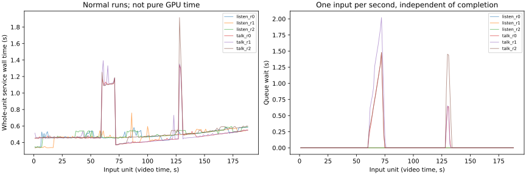

[项目首页](../../../README.md) · [Venus 主线](../README.md)

# 单会话：实时回放与内部执行定位

本轮完成两类单会话负载各三次实时回放、两段独立 trace，以及已有视觉合并开关的短预检。当前没有实现 PD，也没有得到完整服务容量或音质结论。

## 条件与核验

- 官方 Venus 权重和原生音视频协议，使用已通过检查的重复投影清理路径；主体与波形模块分别放在一张 RTX 3090。
- 同一段 188 单元音视频，每秒到达一帧、约一秒声音。`listen` 不加文字问题；`talk` 在第 60／128 单元加入原官方问题。
- 每类三次，反转部分执行顺序；输入不等待模型完成。两类各有新的未修改原生参考输出，其中 talk 另匹配此前冻结的官方参考。
- 正常六组共完成 1,128 单元，无已到达未完成项；所有输出签名、负载资格检查通过。没有观察到其他计算进程占用所选 GPU。
- 另有 376 单元参考运行、252 单元 trace 前缀执行，其中 34 单元被采集；它们不混入正常性能统计。

## 正常回放结果

所有时长单位为秒。完整返回延迟从计划可用时刻计，包含排队；服务时间从实际开始到返回计。表中两个 API 时长是主机墙钟，不是纯语言模型 GPU 时间。

| 运行 | 完成 | 说话单元 | 平均服务 | 平均 API prefill / generate | 完整返回 P95 | 最大排队 |
|---|---:|---:|---:|---:|---:|---:|
| listen_r0 | 188 | 0 | 0.488 | 0.372 / 0.113 | 0.578 | 0.000 |
| listen_r1 | 188 | 0 | 0.477 | 0.364 / 0.111 | 0.562 | 0.000 |
| listen_r2 | 188 | 0 | 0.496 | 0.377 / 0.115 | 0.584 | 0.000 |
| talk_r0 | 188 | 15 | 0.513 | 0.343 / 0.168 | 1.641 | 1.478 |
| talk_r1 | 188 | 15 | 0.516 | 0.344 / 0.170 | 1.809 | 2.021 |
| talk_r2 | 188 | 15 | 0.548 | 0.369 / 0.177 | 1.851 | 1.481 |

无额外提问的三次回放没有明显积压。带问题负载每次有 15 个说话单元，其平均服务时间约 1.14—1.19 秒；说话区间会积压，最大等待约 1.48—2.02 秒。整轮平均服务时间小于一秒，不代表每个时刻都满足实时期限。

`api_prefill` 包含输入预处理／编码与语言模型调用；`api_generate` 包含语言生成、采样、语音 token 和波形工作。正常测量不在每单元额外同步 GPU，接口返回可能仍有少量尾部 kernel；这些值不是精确 GPU 完成时间或首 token 延迟。

## 独立 trace：两个区间表现不同

两段均从起点执行正确前缀，再尽快处理并捕获指定区间。speech 是第 55—76 单元，long_listen 是第 165—176 单元，输出均匹配参考。profile 耗时不用于正常延迟或加速比。

| 区间 | 捕获单元 | 其中说话 | 任一卡有 kernel 的时间比例 | LLM 主体占记录 kernel 时长之和 |
|---|---:|---:|---:|---:|
| speech | 22 | 12 | 42.9% | 70.8% |
| long_listen | 12 | 0 | 91.2% | 88.8% |

长历史倾听片段以 LLM 主体的 GPU 执行为主要组成；说话片段还涉及明显的语音路径及提交／等待间隙。不能笼统认定整个系统都受 CPU 限制，也不能把 kernel 活动比例当成 SM occupancy、带宽或算力饱和率。

两区间的历史、内容、输出状态与预热过程不同；首个说话区间还可能含语音模块首次使用效应。比例差异是定位线索，不是这些变量的隔离因果证明。CPU NVTX 范围是包含式调用时间，并与 GPU 执行重叠，不能直接相加。

## 下一项优化：先对齐上游已有视觉合并能力

长历史 12 单元里，输入接入 API 共调用 LLM 60 次：36 次单 token、24 次多 token；生成 API 另有 24 次单 token调用。单 token 还包括控制标记，不能全部叫“输出文字 decode”。

源码核查发现原生 `streaming_prefill` 已有 `batch_vision_feed=True`：把同一帧的 `<image>`、视觉向量和 `</image>` 合并 feed。它不是跨会话合批，也不是我们提出的新方法。

已做 16 单元／版本的独立预检，第 5 单元提问。原生分支匹配此前冻结记录：

- 输入接入的 LLM feed 调用：未合并 81 次 → 合并 49 次。
- 文字、控制标记、token 数、波形长度、KV 长度在所测 16 单元一致。
- 4 个单元波形哈希不同，抽查 KV 数值也不同；没有通过预先固定的逐字节一致门槛。
- 原生代码也注明合并与逐次计算可能有浮点差异。当前结果不能证明音质变差或任务错误，也不能证明音质等价。

本轮不据此报告等输出加速比，不默认替换现有参考路径。下一项具体工作是单独预注册工作量一致对照：固定输入，逐单元核对交互状态、LLM／TTS token 数、KV 长度与波形样本数，再配对测时；数值与音质变化另列。这样既不改变本轮严格门槛，也不把波形哈希相同当成唯一的架构有效性判断。

## 对单会话 PD 的判断

当前同会话的语言模型仍有 `输入处理 → 当前生成 → 下一次输入处理` 的依赖。保持该语义、又没有新增重叠时，拆卡会增加状态交接和同步，不能仅靠 P／D 分开就推导出加速。

按解析后的配置，BF16、36 层、8 个 KV heads、head_dim=128，稠密语言 KV 的有效载荷估计为每 token 144 KiB。测得最大最终历史 15,017 token，对应约 2.06 GiB；通常一个输入单元新增约 11.11 MiB。

这是基于配置和实测长度的载荷估计，不是实际 tensor 分配、KV connector 搬运量或 PD 时延。它说明后续必须区分整份前缀交接与增量交接，并固定编码、TTS／波形的放置。

**当前优先补强单会话输入的执行粒度，不直接展开完整 PD 重构。**后续 PD 对照仍需相同总 GPU 预算、同样输入／输出工作量、最新会话状态，以及真实交接成本。

## 复核

[运行与测量口径](../single-session.md) · [固定配置](../../../configs/venus/single-session.json) · [聚合数据与源码哈希](../../data/venus-single-session.json)

本轮 19 项 Venus 相关回归检查通过。原始输出、失败／停止记录、资源采样、数值预检和文件哈希保存在私有归档；大 trace 的原件保存在服务器，精简归档保留其哈希。没有真实播放器、音质、硬件计数器饱和证明或 PD 收益结论。
