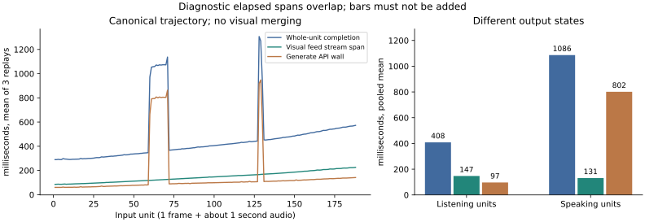

[Venus 主线](../README.md) · [测量方法](../unit-breakdown.md)

# 视觉 feed 与完整单元：耗时占比定位

保持关闭视觉合并的原生生成轨迹，主体／波形分别使用一张 RTX 3090。完整预热 188 单元，再测三遍共 564 单元；全部输出匹配冻结参考，视觉三次 feed 形状均为 1＋64＋1。每单元边界等待两个 GPU 完成，模块之间不加同步。

三遍合并统计：倾听单元平均完成 408 ms，视觉经过 147 ms（约 36%）；说话单元平均完成 1,086 ms，视觉经过 131 ms（约 12%），生成接口墙钟约 802 ms。说话时需要继续定位生成接口内部，不能将其全部归为语言模型 decode。两类状态对应的历史和内容也不同，不能把视觉时间差单独归因于状态。

## 三遍分别统计

所有时间单位为毫秒。完整单元是完成墙钟；prefill／generate 是接口墙钟；视觉是 GPU 0 流上经过时间。它们存在嵌套和重叠，不能直接相加。

| 重复 | 状态 | 单元 | 完整单元均值 | prefill 均值 | generate 均值 | 视觉经过均值 | 视觉／完整时间 |
|---|---|---:|---:|---:|---:|---:|---:|
| 0 | listen | 173 | 408.0 | 297.5 | 96.9 | 147.0 | 36.0% |
| 0 | speak | 15 | 1091.1 | 283.7 | 806.1 | 130.8 | 12.0% |
| 1 | listen | 173 | 408.8 | 298.0 | 97.0 | 147.3 | 36.0% |
| 1 | speak | 15 | 1085.2 | 283.7 | 800.3 | 131.4 | 12.1% |
| 2 | listen | 173 | 408.4 | 297.8 | 96.8 | 147.2 | 36.0% |
| 2 | speak | 15 | 1083.1 | 283.8 | 798.1 | 131.4 | 12.1% |

## 如何解释

视觉输入的局部加速有价值，但其时间只是完整单元的一部分。说话状态还需要语言生成、TTS、波形及其提交／等待。即使视觉段快两倍，也不能把整单元耗时直接除以二。

表中的百分比是经过时间的比例，不是已经证实可删除的关键路径份额：视觉 GPU 计算可以与后续 CPU 预处理重叠。若只优化视觉段，实际节省还取决于重叠、其他阶段及生成行为。没有在本轮启用合并版本测端到端收益。

本轮最快速度回放且在单元边界同步，节奏和之前逐秒到达测试不同。因此这些数值用于定位，不能替换正常实时延迟、音频播放、服务容量或实际合并加速比。三遍来自同一片段，不是三个独立视频样本。

## 下一项判断

应优先解释说话阶段的剩余路径，并在明确固定工作量／质量口径后测试完整优化路径。官方视觉合并应作为强基线候选；其自由生成工作量变化仍保留。当前没有新增 PD、硬件饱和证明或新颖性结论。

后续已完成预热后的[生成接口内部定位](generate-breakdown.md)，区分语言模型、语音 token、波形和控制范围，并提供独立 GPU 时间线。

[聚合数据、逐单元三遍均值和哈希](../../data/venus-unit-breakdown.json) · [固定配置](../../../configs/venus/unit-breakdown.json) · [固定历史微测](vision-compute.md) · [自由生成检查](vision-batch.md)
