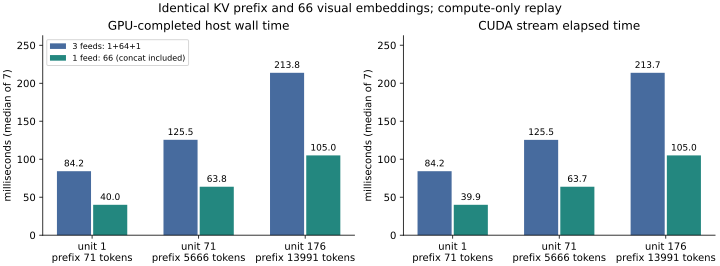

[Venus 主线](../README.md) · [测试方法](../vision-compute.md)

# 固定历史：视觉输入合并计算测试

在两张 RTX 3090 的原生主体／波形部署上，先执行 176 单元原生轨迹，逐项匹配冻结参考。在第 1、71、176 单元捕获视觉输入前的实际 KV 和 66 个输入向量。正式重放只使用主 GPU，比较 1＋64＋1 三次 feed 与拼接后一次 feed；不采样新 token。

三个历史点各预热两对、正式测七对，交替执行顺序：共 42 次正式测量、12 次预热。每次独立恢复同样的前缀和输入；恢复／上传在计时外。所有 KV 长度检查、历史快照不可变检查通过。

| 原轨迹单元 | 前缀 token | 三次 feed：完成墙钟中位数 ms | 一次 feed：完成墙钟中位数 ms | 配对时间比中位数（三次／一次） | 七对比值范围 |
|---|---:|---:|---:|---:|---:|
| 1 | 71 | 84.23 | 39.96 | 2.102 | 2.094—2.124 |
| 71 | 5666 | 125.51 | 63.79 | 1.969 | 1.965—1.974 |
| 176 | 13991 | 213.78 | 105.03 | 2.036 | 2.030—2.043 |

墙钟从同步后的调用开始到主 GPU 完成，包含 Python 提交和等待；一次 feed 的拼接也计入。CUDA event 是流上经过时间，可包含提交间隙，不是所有 kernel 时长之和。各对原始计时、峰值显存和数值诊断见聚合数据。

这些比值仅对应已准备好的视觉向量送入语言模型的局部计算，不含编码、生成、语音、排队或历史恢复成本，不能视为完整系统加速比。三个快照来自一个片段，不是独立视频样本；少量重复不能推断普遍显著性。

新 KV 抽查值随计算分组改变：三个点的抽样相对 L2 差异约为 0.0270、0.0232、0.0125，抽样位置仅覆盖首／中／末层末 token 的部分通道，不代表整份 KV 的误差。本轮没有比较任务准确率或音质，也没有推翻此前自由生成时工作量漂移的结果。官方开关是已有能力；本轮没有新增 PD 或新颖性结论。

正式结论应结合局部计时、原生轨迹里该段占比和自由生成行为。若继续报告端到端收益，必须同时处理工作量和交互质量可比性。

[逐次数据、配置与哈希](../../data/venus-vision-compute.json) · [配置](../../../configs/venus/vision-feed-compute.json) · [此前自由生成检查](vision-batch.md)
