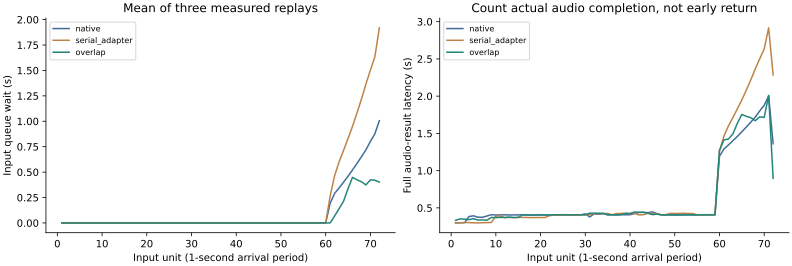
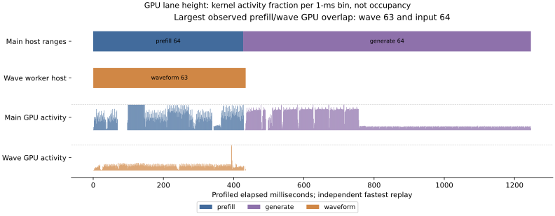

[Venus 主线](../README.md) · [设计与运行方法](../wave-overlap.md)

# 波形与下一输入重叠：原型验证

语言 KV 和语音 token 仍在原来的主 GPU 按顺序计算；波形执行者在原来的第二张 GPU 按 FIFO 处理波形及回合重置。不改模型权重、CUDA 算子或 GPU 数量。异步分阶段属于[已有模式](https://docs.vllm.ai/projects/vllm-omni/en/stable/design/feature/async_chunk/)，本轮不声称新意或语言 P/D 分离。

**结论：输出核验通过，GPU 重叠确实发生，但相对原生的延迟收益不稳定，原型保持实验状态，不默认启用。**三轮声音结果 P95（秒）分别为原生／重叠：1.600／1.537、1.703／2.376、1.853／1.267。不能据此报告稳定提速。

## 输出核验

原生、串行适配、重叠三个版本各完整运行 188 单元，共 564 单元。逐单元文字、控制、token 数、KV 长度、波形哈希匹配；第 1、71、188 单元抽查语言 KV 也匹配。试次之间排空执行者后重置，运行中不做完整会话／随机状态切换。

## 逐秒到达测试

每版本三遍，每遍 72 单元，共 648 单元；独立源每秒输入一次，轮换版本顺序。下表时间单位为秒。声音结果延迟从输入计划可用到语言结果及对应声音均准备好；不是函数提前返回时间，也不是实际播放首声。

| 重复 | 版本 | 完成 | 声音结果 P95 | 声音结果最大 | 最大输入排队 | 首说话单元返回 |
|---|---|---:|---:|---:|---:|---:|
| r0 | native | 72 | 1.600 | 1.875 | 0.875 | 1.144 |
| r0 | overlap | 72 | 1.537 | 1.636 | 0.295 | 1.239 |
| r0 | serial_adapter | 72 | 2.533 | 3.169 | 2.170 | 1.255 |
| r1 | native | 72 | 1.703 | 2.004 | 1.004 | 1.208 |
| r1 | overlap | 72 | 2.376 | 2.892 | 1.206 | 1.350 |
| r1 | serial_adapter | 72 | 2.030 | 2.354 | 1.356 | 1.282 |
| r2 | native | 72 | 1.853 | 2.136 | 1.136 | 1.226 |
| r2 | overlap | 72 | 1.267 | 1.499 | 0.000 | 1.226 |
| r2 | serial_adapter | 72 | 2.596 | 3.228 | 2.230 | 1.252 |

所有已到达单元均完成、无丢弃，源端迟到资格检查通过；每遍的实际输出都匹配冻结参考。串行适配使用同一个波形执行者但立即等待，用来检查适配层本身的成本；必须同时看原生对照。

每次适配试次创建新的波形线程；首个 GPU 使用可能有线程／库初始化影响，本轮未排除该效应。首说话单元与最大延迟单列，不能只挑平均或 P95。三次重复来自同一片段，结论仅限此原型和负载，尚不能宣称长期服务容量或通用端到端加速。

## 主流程为什么还会变慢

下表为实际说话单元的主机范围均值，单位秒。重叠模式的 generate 是任务提交返回时间，不能与原生 generate 的完整声音返回时间直接当作同一项加速比较。

| 运行 | prefill 主机均值 | generate 主机返回均值 |
|---|---:|---:|
| r0_native | 0.272 | 0.800 |
| r0_overlap | 0.346 | 0.621 |
| r1_native | 0.274 | 0.809 |
| r1_overlap | 0.384 | 0.711 |
| r2_native | 0.277 | 0.817 |
| r2_overlap | 0.325 | 0.602 |

重叠时 prefill 范围在三轮里均变长，第二轮的主流程已接近或超过每秒到达预算。这是观察到的退化，尚未隔离线程／CPU／驱动竞争等原因。首个波形作业也更慢，但后续作业仍有变慢，不能只归因于首次初始化。下一步先隔离这些执行开销，再决定是否采用或测试独立进程；不先扩大成完整 PD 重构。

后续已做[固定波形状态的线程隔离](worker-isolation.md)：预热确有影响，但未消除全部差距，仍不据此认定整条管线的根因。

## 独立 GPU 证据

另在新进程完整预热 188 单元，重放 72 单元并捕获第 55—72 单元。GPU 0 后续输入 prefill 的 kernel 与 GPU 1 较早单元波形 kernel 的实际交集为 502.590 ms，涉及 12 对单元。该 trace 是最快回放诊断，不混入正常延迟。

示例选择 GPU kernel 交集最大的一对，展示机制而非典型延迟。GPU 每 1 ms 小格的高度是 kernel 活动时间比例，虚线对应 100%，不是 SM occupancy。

## 使用边界

只支持单个连续会话、固定声音和已审核源码；委派／静音分支明确拒绝。尚未支持多会话状态切换、完整生产取消协议、实际播放器或其他模型。不能用这个原型替代完整 serving 系统，也不能将已有异步执行模式当作论文创新。

69 项回归检查中 68 项通过、1 项跳过。原始记录、实际源码、配置、资源采样和哈希在私有归档；大 trace 留在服务器，归档保留校验值。

[完整数据和哈希](../../data/venus-wave-overlap.json) · [适配代码](../../../src/stream_pipeline/venus_wave_overlap.py) · [测试入口](../../../scripts/venus/wave_overlap_probe.py) · [独立 trace 入口](../../../scripts/venus/wave_overlap_trace.py)
