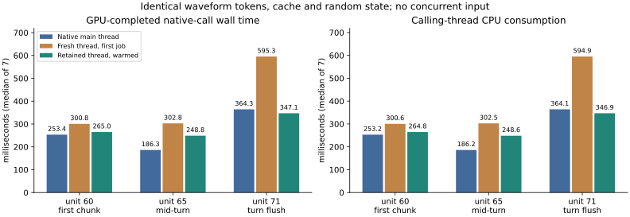

[Venus 主线](../README.md) · [隔离方法](../worker-isolation.md)

# 波形线程首次使用：固定状态隔离

先执行 188 单元正确原生轨迹，捕获第 60、65、71 单元的波形输入、缓存及随机状态。每次恢复同一份状态后，比较原生主线程、新线程第一次执行、保留线程预热后执行。主模型不再提交并行输入计算。

**结论：线程首次使用有可测影响，但预热不能消除全部差距，尚不能解释上一轮整条管线的退化。**第 65 单元的原生／新线程／预热线程中位时间约 186／303／249 ms，预热后仍比原生慢约 63 ms。异步原型继续保持实验状态。

正式 63 个波形任务、预热 12 个任务，所有输出形状及哈希与原生快照一致，快照不可变检查通过。主线程每个快照为同一个线程，保留工作线程也是同一个线程，新工作线程为七个不同的原生线程 ID。

## 原生波形函数至 GPU 完成的时间

单位为毫秒，表中为七次测量的中位数；线程创建、缓存恢复、输入快照校验在计时外。CUDA event、线程 CPU、进程 CPU 与 API 往返另存数据。

| 波形任务来自 | 原生主线程 | 新工作线程首次执行 | 保留线程预热后 | 配对差中位数：新－预热 | 配对比中位数：新／预热 |
|---|---:|---:|---:|---:|---:|
| 60 | 253.37 | 300.80 | 265.03 | 24.76 | 1.090 |
| 65 | 186.31 | 302.75 | 248.84 | 55.76 | 1.227 |
| 71 | 364.28 | 595.33 | 347.05 | 248.87 | 1.717 |

“配对差／配对比中位数”是每轮先求差／比，再取七轮中位数，不等于直接对前面两列中位数做运算。第 60 单元的七轮配对差范围跨过零，首段效果有波动；第 65、71 单元的配对差在本轮均为正，说明新线程较慢。

线程 CPU 是该调用线程被调度执行消耗的 CPU 时间，不包含其他 PyTorch CPU 线程；墙钟含 GPU 执行、提交和等待。二者不能简单相减就称作 GPU 时间。首段快照保留原生未准备好的提示缓存时，每个版本都会重复相同的提示准备工作，不能把不同快照之间的差异归因于线程。

## 与上一轮的关系

本轮只隔离新线程／已使用线程的差异，没有与下一份输入并行，也没有测长时间闲置后的 GPU 唤醒。因此不能把本轮差值直接等同于上一轮 prefill 变慢或完整声音结果 P95 的原因。上一轮还观察到后续波形任务和主流程变慢，仍需分开核查竞争／线程局部配置等因素。

三种方式记录到的 PyTorch intra-op 线程数均为 8。调用线程 CPU 消耗接近墙钟，例如第 65 单元预热线程约 248.6／248.8 ms；这可能包含 CUDA 提交、驱动轮询或其他主机工作，不等于纯 Python 计算，更不能直接认定 GIL 是原因。

下一步先对同一固定任务采逐调用时间线，比较原生与预热线程的 kernel 组成、提交间隙和同步 API，定位剩余差距，再决定是否需要进程隔离。暂不扩大系统重构。

当前不修改默认路径，不据此宣布异步管线已稳定提速。所有包、原生模型和 GPU 放置沿用既有环境；这是原生计算的诊断，不是新算法、PD 或音频播放测试。

72 项回归检查：71 项通过、1 项跳过。原始输出、逐次计时、源码、资源采样和哈希保留在私有归档。

[逐次数据与哈希](../../data/venus-worker-isolation.json) · [固定配置](../../../configs/venus/wave-worker-isolation.json) · [上一轮重叠结果](wave-overlap.md)
